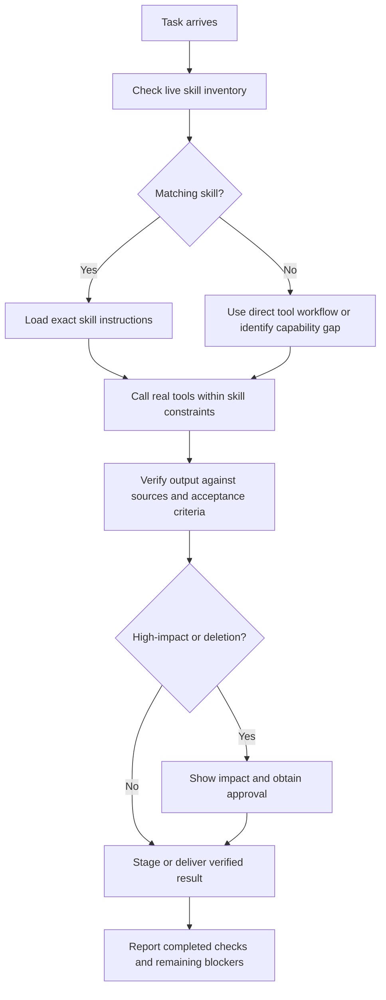

# Hermes Skills — Registry and Operating Guide

**Purpose:** Human-readable index for the active Hermes skills, their local classification, and safe skill/tool use. This is not a replacement for individual skill instructions.

## Authority and scope

- Each installed skill's `SKILL.md` is authoritative for that skill's behavior, triggers, constraints, and procedures.
- Hermes' live skill inventory is authoritative for which skills are currently available and for runtime category metadata. Check it with `skills_list`; do not infer availability from this document.
- This document is the user-defined index for abbreviations and category letters. It does not configure or invoke tools.
- The server's saved ID examples/patterns are intentionally kept in the server reference, not duplicated here.
- `termux-operations` has no runtime category in the current Hermes inventory. In this local classification it is labeled `effectiveness` (`e`), matching the user-supplied taxonomy; this does not change its Hermes runtime metadata.

## Category letter map

| Letter | Category |
|---|---|
| `a` | audit |
| `c` | autonomous-ai-agents |
| `e` | effectiveness |
| `p` | productivity |
| `r` | research |
| `s` | software-development |

This is the complete local map supplied by the user. `d` is not a category in this map. Do not silently add, remap, or infer category letters. If a future skill does not fit, flag it for classification instead of guessing.

## Identifier fields

A local skill reference may combine a domain flag, category letter, unique abbreviation, and an action suffix. Domain flags are `f` (front-end) and `b` (back-end); action suffixes are listed below. These are human-facing classification/workflow labels only: Hermes does not use them to load a skill or call a tool. Use the actual skill nammap concrete ID examples and patterns.

### Action suffixes

| Suffix | Meaning |
|---|---|
| `-v` | validate/check |
| `-c` | create |
| `-p` | patch/update |
| `-d` | delete |
| `-t` | test |

Use suffixes to label a requested workflow action, not as a substitute for the stable skill name. Deletion is a high-impact action and requires explicit user approval.

## Current skill inventory

The runtime names/categories below were checked against `skills_list`. "Local category letter" is the vault classification; abbreviations must be unique in this table.

| Hermes skill name         | Runtime category     | Local category       | Letter | Abbreviation |
| ------------------------- | -------------------- | -------------------- | ------ | ------------ |
| `termux-operations`       | unset                | effectiveness        | `e`    | `tm`         |
| `obsidian-audit`          | audit                | audit                | `a`    | `ob`         |
| `claude-code`             | autonomous-ai-agents | autonomous-ai-agents | `c`    | `cl`         |
| `codex`                   | autonomous-ai-agents | autonomous-ai-agents | `c`    | `cx`         |
| `computer-use`            | autonomous-ai-agents | autonomous-ai-agents | `c`    | `cu`         |
| `hermes-agent`            | autonomous-ai-agents | autonomous-ai-agents | `c`    | `he`         |
| `caveman`                 | productivity         | productivity         | `p`    | `ca`         |
| `caveman-compress`        | productivity         | productivity         | `p`    | `cv`         |
| `caveman-discover`        | productivity         | productivity         | `p`    | `cd`         |
| `caveman-explore`         | productivity         | productivity         | `p`    | `ce`         |
| `config-cleanup`          | productivity         | productivity         | `p`    | `cf`         |
| `context-extraction`      | productivity         | productivity         | `p`    | `cx`         |
| `extract-action-items`    | productivity         | productivity         | `p`    | `ex`         |
| `maps`                    | productivity         | productivity         | `p`    | `ma`         |
| `obsidian`                | productivity         | productivity         | `p`    | `ox`         |
| `pdf`                     | productivity         | productivity         | `p`    | `pd`         |
| `grounded-citations`      | research             | research             | `r`    | `gr`         |
| `skill-id-schema`         | research             | research             | `r`    | `sk`         |
| `codebase-inspection`     | software-development | software-development | `s`    | `ci`         |
| `dogfood`                 | software-development | software-development | `s`    | `df`         |
| `github`                  | software-development | software-development | `s`    | `gi`         |
| `requesting-code-review`  | software-development | software-development | `s`    | `re`         |
| `simplify-code`           | software-development | software-development | `s`    | `si`         |
| `spike`                   | software-development | software-development | `s`    | `sp`         |
| `systematic-debugging`    | software-development | software-development | `s`    | `sy`         |
| `test-driven-development` | software-development | software-development | `s`    | `te`         |

**Total: 26 skills** (verified against `skills_list` at 2026-11-23)

## How skill and tool calling actually works

1. **Discover:** call `skills_list` to see the live set and descriptions. This avoids relying on a stale inventory. 
2. **Load/read:** use `skill_view(name="exact-skill-name")` to inspect the skill before following an unfamiliar procedure. Follow its boundaries and linked references.
3. **Act:** call the real available tool (for example, file, browser, or terminal tools) required by the procedure. Compact IDs in this document are not callable tool names.
4. **Verify:** inspect actual tool output and validate the result against task acceptance criteria. Do not report an action as complete based on a plan or an attempted call.
5. **Stage safely:** preserve source and provenance for information integration. Use review staging for drafts; do not promote to durable memory or perform high-impact/deletion operations without the required approval.

## Skill routing and overlap boundaries

| Need                                       | Route to                          | Boundary / caution                                                                                                                                      |
| ------------------------------------------ | --------------------------------- | ------------------------------------------------------------------------------------------------------------------------------------------------------- |
| Find relevant repository files             | `caveman-explore`                 | Read-only localization; it does not implement fixes.                                                                                                    |
| Extract actions from documents/transcripts | `extract-action-items`            | Preserve evidence and mark unresolved fields; do not execute proposed external actions without approval.                                                |
| Retrieve context excerpts                  | `context-extraction`              | Lexical retrieval of source-linked verbatim text; it is not semantic compression.                                                                       |
| Compress prose                             | `caveman-compress`                | Lossy model-based rewrite; sends input to the configured provider and overwrites after backup. Do not use automatically for evidence or durable memory. |
| Work with Obsidian files                   | `obsidian`                        | General filesystem-first vault work; follow RO/RW/Temp boundaries.                                                                                      |
| Audit/reorganize vault                     | `obsidian-audit`                  | Gather evidence, propose itemized changes, and wait for confirmation before reorganization.                                                             |
| Debug code                                 | `systematic-debugging`            | Root-cause investigation before changing code.                                                                                                          |
| Implement with tests                       | `test-driven-development`         | Use for code changes where test-first development fits.                                                                                                 |
| Review a code diff                         | `requesting-code-review`          | Quality/security review; do not conflate with code cleanup.                                                                                             |
| Simplify existing code                     | `simplify-code`                   | Cleanup task; preserve behavior and verify tests.                                                                                                       |
| Delegate coding                            | `claude-code` or `codex`          | Choose the available agent appropriate to the task; delegation does not replace review.                                                                 |
| Ground research claims                     | `grounded-citations`              | Supports external-source evidence; retain internal file/line provenance separately.                                                                     |

Do not merge skills merely because their names or triggers overlap. Keep a narrow skill when it has distinct inputs, outputs, side effects, or safety constraints. Prefer an orchestration skill that routes between compatible specialists over a monolithic skill that duplicates their procedures.

## Skill creation and update checklist

- [ ] Define trigger, purpose, inputs, outputs, non-goals, failure behavior, and side effects.
- [ ] Check the live inventory and existing skill procedures for overlap before creating or merging.
- [ ] Assign a local category from the supplied map; flag unclassified cases instead of guessing.
- [ ] Assign a unique abbreviation and check it against this inventory.
- [ ] Create or update the real skill through Hermes' skill-management mechanism; do not use unverified CLI syntax.
- [ ] Test representative triggers, non-triggers, tool calls, and safety boundaries; inspect actual results.
- [ ] Re-read the final skill and verify its metadata, links, instructions, and claims against the acceptance criteria.
- [ ] Update this table only after the installed skill inventory and category are verified.
- [ ] Before deletion or other high-impact changes, show exact targets, rationale, and expected impact; wait for explicit approval.

## End-to-end workflow

## Maintenance and validation

- Refresh the inventory from `skills_list` when reviewing this file; installed skills may change.
- Keep the category map and abbreviation table here as the local index; do not copy the server's ID examples into this file.
- Treat unverified mappings, unsupported commands, and untested Mermaid or tool workflows as unresolved—not as established facts.
- For consolidation, preserve originals until the replacement has been checked for completeness, consistency, links, and successful use.